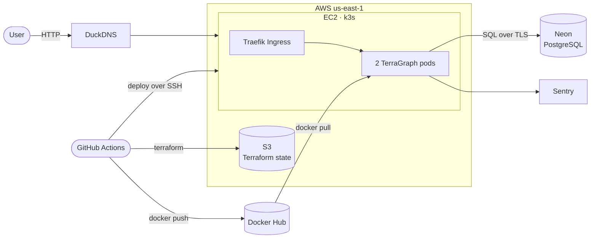

# TerraGraph

[](https://github.com/DinoHuerta0/TerraGraph/actions/workflows/ci.yml)
[](https://github.com/DinoHuerta0/TerraGraph/actions/workflows/cd.yml)

**Graph-based analyzer for Terraform plans.** Final project for the CI/CD course.

TerraGraph is a web service that takes a Terraform plan in JSON format (the output of `terraform show -json`), builds the directed dependency graph between its resources, and answers three questions:

- **In what order are the resources created?** Topological order, grouped into levels that can be created in parallel.
- **What breaks if I destroy this resource?** The blast radius: every resource that depends on it, directly or transitively.
- **Does the plan have circular dependencies?** Cycles are detected and reported.

The graph is drawn in the browser with Cytoscape.js, and it can be exported to JSON, DOT (Graphviz) and Mermaid.

> **Live demo:** <http://terragraph.duckdns.org>. The AWS infrastructure is created and destroyed on each work session, so the demo is only online while a session is running.

## Table of contents

- [How to use it](#how-to-use-it)
- [API](#api)
- [Architecture](#architecture)
- [Tech stack](#tech-stack)
- [Local development](#local-development)
- [Configuration](#configuration)
- [Deployment](#deployment)
- [Project structure](#project-structure)
- [Known limitations](#known-limitations)
- [Documentation](#documentation)

## How to use it

1. Export a plan from any Terraform project:

   ```bash
   terraform plan -out=plan.tfplan
   terraform show -json plan.tfplan > plan.json
   ```

   For a "what happens if I destroy everything" plan, use `terraform plan -destroy -out=plan.tfplan`. It only computes the plan; nothing is destroyed.

2. Open TerraGraph, upload `plan.json` and give the analysis a name.
3. Explore the graph:
   - Click a node to see its details and highlight its blast radius.
   - Click the background to clear the highlight.
   - Switch between light and dark mode with the button in the header.
4. Share the analysis with its link (`/?id=<uuid>`). The plans you upload are also listed under **My analyses**.

> [!WARNING]
> **Remove secrets before uploading a plan.** A plan JSON includes the values of `sensitive` variables in plain text (database URLs, tokens, passwords). TerraGraph stores the whole plan, and anyone with the link can open it. Replace those values before uploading the file.

## API

The interactive documentation (OpenAPI) is available at `/docs`.

| Method | Path | Description |
|---|---|---|
| `GET` | `/health` | Health check used by the Kubernetes probes |
| `POST` | `/api/analyses` | Receives `{"name", "plan"}`, stores the plan and returns `201` with its `id` and the analysis |
| `GET` | `/api/analyses/{id}` | Graph, creation order, parallel levels and cycles |
| `GET` | `/api/analyses/{id}/blast-radius?address=…` | Resources affected by the given resource |
| `GET` | `/api/analyses/{id}/export?format=…` | Graph as `json`, `dot` or `mermaid` |
| `GET` | `/` | Web page with the graph and **My analyses** |

Errors: `404` if the analysis or the resource does not exist, `413` if the plan is larger than 2 MB, and `422` if the plan is invalid or a parameter is missing. The body is always `{"detail": "…"}`.

Example:

```bash
# Create an analysis (the request body wraps the plan with a name)
jq -n --slurpfile plan plan.json '{name: "my-plan", plan: $plan[0]}' \
  | curl -s -X POST http://localhost:8000/api/analyses \
      -H "Content-Type: application/json" -d @-

# Blast radius of a resource (addresses may contain brackets and quotes)
curl -s -G http://localhost:8000/api/analyses/<id>/blast-radius \
  --data-urlencode 'address=aws_vpc.main'
```

## Architecture

The code is split into three layers:

- **Graph core** (`app/core/`): pure Python with no external dependencies. `PlanParser` builds a `ResourceGraph`, then `CycleDetector` (DFS), `OrderPlanner` (Kahn's algorithm), `BlastRadiusCalculator` (BFS on the reversed graph) and `GraphExporter` analyze it. `GraphAnalyzer` is the facade that ties them together.
- **Application** (`app/`): FastAPI routers, `AnalysisService` (2 MB limit and validation), and `AnalysisRepository` (SQLAlchemy) for PostgreSQL.
- **Front end** (`app/static/`): HTML and JavaScript with no build step. Cytoscape.js is stored in the repository, so the image does not depend on a CDN.

Design decisions:

- **The plan is stored, not the result.** The analysis is recomputed on every request, so an improvement in the algorithms also applies to analyses that were already saved.
- **No user accounts.** Each analysis has a random UUID and is available through its own link. The browser remembers the analyses it uploaded (**My analyses**, in `localStorage`).
- **Data lives outside AWS.** The database is hosted on Neon, so the AWS infrastructure can be destroyed after every session without losing data.



The full design (class diagrams, infrastructure, deployment, tests and work plan) is in the [Wiki](https://github.com/DinoHuerta0/TerraGraph/wiki).

## Tech stack

| Layer | Technology |
|---|---|
| Language and API | Python 3.12, FastAPI, Uvicorn, Pydantic |
| Database | PostgreSQL on Neon; SQLAlchemy and Alembic |
| Front end | HTML, JavaScript, Cytoscape.js |
| Tests and quality | pytest, pytest-cov, httpx2, `node --test`, Ruff |
| Monitoring | Sentry |
| Containers | Docker (multi-stage), Docker Hub, Docker Compose for local development |
| CI/CD | GitHub Actions |
| Infrastructure | Terraform (S3 state), AWS (VPC, EC2), k3s with Traefik, DuckDNS |

## Local development

Requirements: Python 3.12, Docker and Node.js (only for the JavaScript tests). The commands are for Git Bash on Windows; on Linux or macOS, activate the virtual environment with `source .venv/bin/activate`.

```bash
# 1. Virtual environment and dependencies
python -m venv .venv
source .venv/Scripts/activate
pip install -r requirements-dev.txt

# 2. Local Postgres (in a container) and migrations
docker compose -f docker/docker-compose.yml up -d
alembic upgrade head

# 3. Run the app at http://localhost:8000
uvicorn app.main:app --reload
```

Without a `.env` file, the app uses the local Postgres from Docker Compose. To use another database or turn on Sentry, copy `.env.example` to `.env` and load it with `set -a; source .env; set +a`.

Tests and quality checks (the same ones that run in CI):

```bash
docker compose -f docker/docker-compose.yml up -d   # the integration tests need Postgres
python -m pytest -v --cov=app --cov-report=term-missing --cov-fail-under=80
node --test "tests/js/*.test.js"
ruff check . && ruff format --check .
```

Build and run the image:

```bash
docker build -f docker/Dockerfile -t terragraph .
docker run --rm -p 8000:8000 -e DATABASE_URL='<url>' terragraph
```

## Configuration

| Variable | Description |
|---|---|
| `DATABASE_URL` | PostgreSQL connection URL. Defaults to the local Docker Compose database. On Neon, use the direct (non-pooled) connection with `sslmode=require`. |
| `SENTRY_DSN` | Sentry DSN. If it is empty, the app runs without monitoring (tests and CI never send events). |
| `SENTRY_ENVIRONMENT` | `development` locally and `production` on the server. |
| `SENTRY_RELEASE` | Version reported to Sentry. The pipeline sets it to the commit SHA. |

Secrets are kept in **three places**. When you rotate one, update all three:

| Where | Used by |
|---|---|
| `.env` | The app on your machine |
| `terraform/terraform.tfvars` (copy of `terraform.tfvars.example`) | `terraform` run from your machine |
| GitHub secrets and variables | The workflows |

GitHub secrets: `DOCKERHUB_TOKEN`, `AWS_ACCESS_KEY_ID`, `AWS_SECRET_ACCESS_KEY`, `AWS_SESSION_TOKEN`, `EC2_SSH_KEY`, `DATABASE_URL`, `SENTRY_DSN` and `DUCKDNS_TOKEN`. GitHub variables: `DOCKERHUB_USERNAME`, `DUCKDNS_DOMAIN` and `TF_STATE_BUCKET`.

On the server, `DATABASE_URL` and `SENTRY_DSN` live in the Kubernetes `Secret` that the instance creates on its first boot. After rotating them, recreate the instance (or update the `Secret` by hand) so the pods use the new values.

## Deployment

### Pipelines

| Workflow | Trigger | What it does |
|---|---|---|
| `ci.yml` | Pull request to `main` | Lint, tests with coverage ≥ 80 %, JavaScript tests and image build (not pushed) |
| `cd.yml` | Merge to `main` or tag `vX.Y.Z` | Same checks, push to Docker Hub (`sha-<commit>`, `latest`, `X.Y.Z`) and, on `main`, deploy with `kubectl set image` and automatic rollback |
| `infra-up.yml` | Manual | `terraform apply` and wait until `/health` responds through the domain |
| `infra-down.yml` | Manual (type `destroy` to confirm) | `terraform destroy` |
| `terraform.yml` | Called by `infra-up` and `infra-down` | Shared credentials, variables, `init`, plan and apply |

### One-time setup

1. Create the S3 bucket for the Terraform state: `bash terraform/bootstrap/create-state-bucket.sh`.
2. Create the Neon database, the DuckDNS subdomain and the Docker Hub repository.
3. Add the secrets and variables listed in [Configuration](#configuration) to GitHub.

### Work session

1. Start the AWS Learner Lab and copy its temporary credentials to the GitHub secrets.
2. Run **infra-up**. Terraform creates the VPC and the EC2 instance, and the instance's `user_data` installs k3s, registers its IP in DuckDNS, creates the Kubernetes `Secret` and applies the manifests in `k8s/`.
3. Work as usual: every merge to `main` deploys the new version.
4. Run **infra-down** to destroy everything that costs credits.

Only the VPC and the EC2 instance are created and destroyed. The S3 bucket, Neon, DuckDNS and Docker Hub are permanent.

To run Terraform from your machine instead of GitHub Actions, fill in `terraform/terraform.tfvars` and run `terraform init -backend-config="bucket=<bucket>"` and `terraform apply` from the `terraform/` folder.

## Project structure

```text
app/
  core/          Graph core: parser, graph, cycles, order, blast radius, exporter, analyzer
  routers/       Health, analyses API and web page
  static/        Web page (HTML, CSS, JavaScript and Cytoscape.js in vendor/)
  db.py, models.py, repositories.py, services.py, schemas.py, monitoring.py
migrations/      Alembic migrations
tests/           pytest (unit and integration), fixtures and JavaScript tests (tests/js/)
docker/          Dockerfile and docker-compose.yml
k8s/             Namespace, Deployment, Service and Ingress
terraform/       AWS infrastructure, user_data and state bucket bootstrap
.github/         CI/CD workflows and issue and PR templates
docs/            Project presentation (Spanish) and its PDF
```

## Known limitations

- **Only the plan JSON is analyzed, not the `.tf` files.** References through `locals` do not appear in the graph, and a reference to one instance of `count` or `for_each` (`aws_instance.app[0]`) creates edges to every instance of that resource.
- **My analyses is stored per browser.** It is lost if the browser clears site data when it closes, and it does not show up in another browser or in incognito mode. The analyses are still in the database and can be opened with their link.
- **Analyses cannot be listed or deleted** through the API. Anyone with the link can open an analysis.
- **HTTP only.** HTTPS with Let's Encrypt was left out of scope.

Possible next steps: user accounts so that each person can see their analyses from any device, deleting analyses, and HTTPS.

## Documentation

- [Wiki](https://github.com/DinoHuerta0/TerraGraph/wiki): full project presentation.
- [`docs/presentation.md`](docs/presentation.md) and [`docs/presentation.pdf`](docs/presentation.pdf): the presentation in Spanish.
- Work plan: GitHub Project board with issues and milestones M1 to M7.
