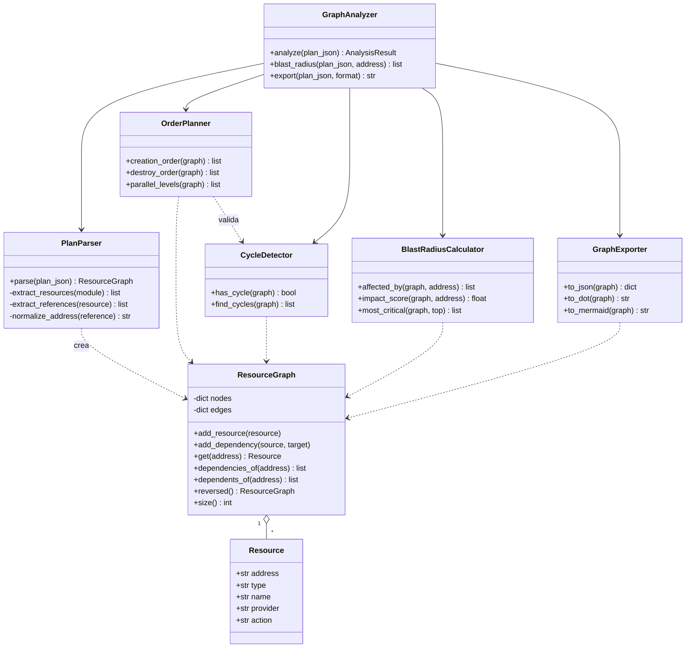
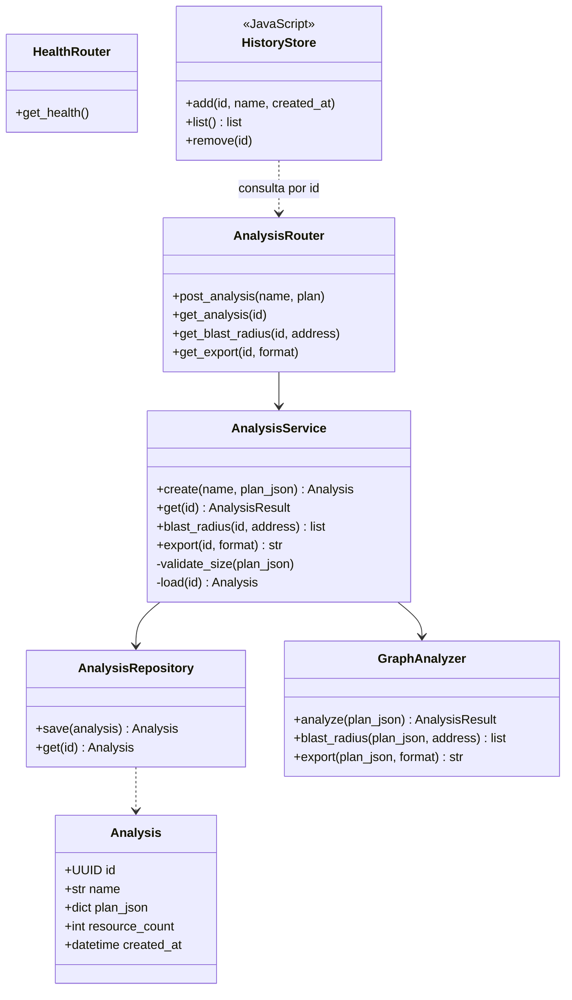
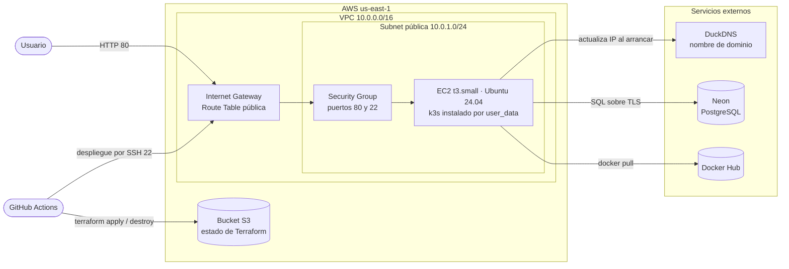
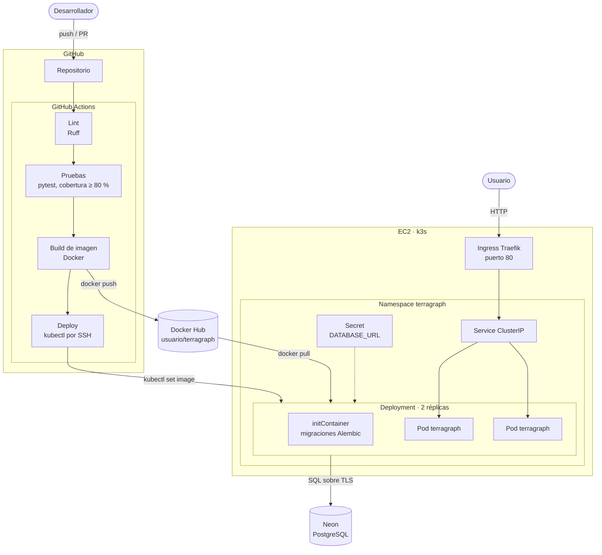
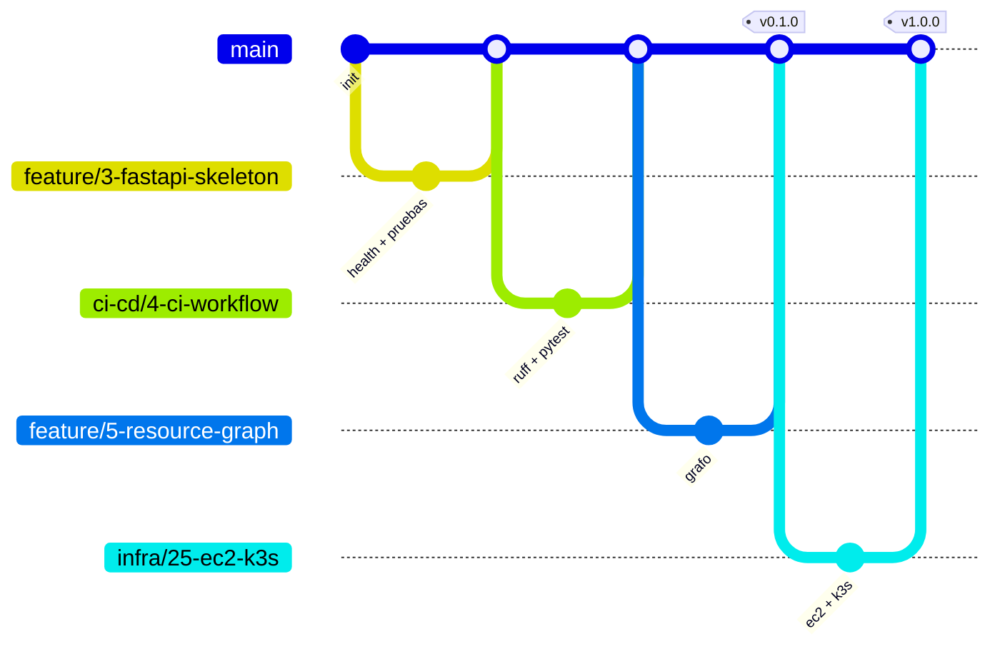

# TerraGraph

**Analizador de infraestructura Terraform basado en grafos**

Proyecto final de CI/CD

---

## 1. Descripción del proyecto

TerraGraph es un servicio web que recibe un plan de Terraform en formato JSON (la salida de `terraform show -json plan.tfplan`), construye el grafo dirigido de dependencias entre recursos y responde tres preguntas:

- **¿En qué orden se crean los recursos?** Orden topológico del grafo, agrupado en niveles que pueden crearse en paralelo.
- **¿Qué se rompe si destruyo este recurso?** Radio de impacto: todos los recursos que dependen, directa o transitivamente, del recurso elegido.
- **¿El plan tiene dependencias circulares?** Detección y reporte de ciclos.

No hay cuentas de usuario. Cada plan que se sube se guarda en PostgreSQL con un identificador aleatorio (UUID) y queda disponible en un enlace propio. La página web recuerda en el navegador los análisis que subió esa persona y los muestra en la sección **Mis análisis**, sin necesidad de iniciar sesión.

Los análisis se guardan en PostgreSQL hospedado en Neon, fuera de AWS. Así la infraestructura de AWS puede destruirse al terminar cada sesión de trabajo sin perder datos ni gastar créditos.

Como demostración, TerraGraph analiza el plan de Terraform de su propia infraestructura.

### Alcance

| Incluido | Fuera de alcance |
|---|---|
| Parseo del JSON de `terraform show` | Ejecutar `terraform plan` o `apply` desde el servicio |
| Orden de creación y destrucción | Estimación de costos |
| Niveles de paralelismo | Soporte de otros IaC (CloudFormation, Pulumi) |
| Radio de impacto | Cuentas de usuario y autenticación |
| Detección de ciclos | Borrar análisis guardados |
| Exportar el grafo a JSON, DOT y Mermaid | Comparar dos planes |
| Guardar y consultar análisis por enlace | Sincronizar el historial entre navegadores |
| Límite de tamaño del plan (2 MB) | |
| Historial **Mis análisis** en el navegador | |
| Visualización web del grafo | |

---

## 2. Componentes y métodos

El código se divide en tres capas: el **núcleo de grafos**, que es lógica pura sin dependencias externas; la **aplicación**, que agrega la API y la persistencia; y el **front**, que dibuja el grafo y guarda el historial en el navegador.

### Diagrama de clases: núcleo de grafos



### Diagrama de clases: aplicación y front



### Responsabilidades

| Componente | Responsabilidad | Algoritmo |
|---|---|---|
| `Resource` | Datos de un recurso del plan (dirección, tipo, acción) | — |
| `ResourceGraph` | Grafo dirigido; una arista A → B significa "A depende de B" | Listas de adyacencia |
| `PlanParser` | Convierte el JSON del plan en un `ResourceGraph` a partir de las referencias y los `depends_on` | Recorrido de módulos |
| `CycleDetector` | Encuentra dependencias circulares | DFS con tres colores |
| `OrderPlanner` | Orden de creación, de destrucción y niveles paralelos | Algoritmo de Kahn |
| `BlastRadiusCalculator` | Recursos afectados al destruir uno y ranking de los más críticos | BFS sobre el grafo invertido |
| `GraphExporter` | Serializa el grafo a JSON, DOT y Mermaid | — |
| `GraphAnalyzer` | Fachada del núcleo: orquesta parser y analizadores | — |
| `Analysis` | Modelo guardado en PostgreSQL | — |
| `AnalysisRepository` | Acceso a la base de datos | — |
| `AnalysisService` | Valida el tamaño del plan, lo guarda y recalcula el análisis al consultarlo | — |
| `HealthRouter`, `AnalysisRouter` | Endpoints HTTP y validación de entrada | — |
| `HistoryStore` | Guarda en `localStorage` los análisis que subió esta persona | — |

Decisiones de diseño:

- **Se guarda el plan, no el resultado.** El análisis se recalcula al consultarlo, así una mejora en los algoritmos aplica también a los análisis ya guardados.
- **Sin autenticación.** La persistencia vive en el servidor y la "identidad" en el cliente. Los análisis no se pueden listar ni borrar desde la API; quien tiene el enlace puede verlo, y el UUID hace que no se pueda adivinar.
- **Límite de 2 MB por plan.** Como cualquiera puede subir planes sin cuenta, el límite evita que se llene la base de datos.

### API

| Método | Ruta | Descripción |
|---|---|---|
| `GET` | `/health` | Verificación de estado para Kubernetes |
| `POST` | `/api/analyses` | Guarda un plan y devuelve su `id` y su análisis (`413` si pesa más de 2 MB) |
| `GET` | `/api/analyses/{id}` | Grafo, orden de creación, niveles paralelos y ciclos |
| `GET` | `/api/analyses/{id}/blast-radius?address=…` | Recursos afectados por un recurso |
| `GET` | `/api/analyses/{id}/export?format=…` | Grafo en JSON, DOT o Mermaid |
| `GET` | `/` | Página web con la visualización del grafo y **Mis análisis** |

---

## 3. Stack tecnológico

| Capa | Tecnología | Uso |
|---|---|---|
| Lenguaje | Python 3.12 | Lógica del grafo y API |
| API | FastAPI + Uvicorn | Endpoints REST y documentación OpenAPI automática |
| Validación | Pydantic | Modelos de entrada y salida |
| Base de datos | PostgreSQL en Neon | Análisis guardados; vive fuera de AWS |
| Acceso a datos | SQLAlchemy + Alembic | Modelos, consultas y migraciones |
| Front | HTML + JavaScript + Cytoscape.js | Dibujo interactivo del grafo e historial en `localStorage`, servido por FastAPI |
| Pruebas | pytest + pytest-cov + httpx2 | Pruebas unitarias, cobertura y `TestClient` |
| Calidad | Ruff | Lint y formato |
| Entorno local | venv + Docker Compose | Dependencias de Python y Postgres en contenedor |
| Contenedor | Docker (multi-stage) | Imagen de la aplicación |
| Registro | Docker Hub | Almacén de imágenes versionadas |
| CI/CD | GitHub Actions | Pruebas, build, push, despliegue e infraestructura |
| IaC | Terraform con estado en S3 | Creación y destrucción de la infraestructura |
| Nube | AWS (VPC, EC2, S3) | Hospedaje y estado de Terraform |
| Orquestación | k3s (Kubernetes) + Traefik | Ejecución del contenedor y entrada HTTP |
| DNS | DuckDNS | Nombre fijo aunque cambie la IP |
| Gestión | GitHub Projects + Issues | Plan de trabajo |
| Documentación | GitHub Wiki | Esta presentación |

### Entorno local

```bash
python -m venv .venv
.venv\Scripts\Activate.ps1          # Windows (PowerShell)
pip install -r requirements-dev.txt
uvicorn app.main:app --reload       # levantar la API
python -m pytest                    # correr las pruebas
ruff check . && ruff format --check .
```

- `requirements.txt` tiene lo que la app necesita para correr; `requirements-dev.txt` agrega las herramientas de desarrollo.
- Las versiones de las dependencias directas están fijadas para que el entorno sea reproducible.
- Las pruebas se ejecutan con `python -m pytest`, que agrega la raíz del proyecto a la ruta de búsqueda de módulos.

---

## 4. Recursos que se van a crear

### Diagrama de infraestructura



El usuario entra por el nombre de DuckDNS, que apunta a la IP pública de la instancia. Terraform, ejecutado desde GitHub Actions, crea y destruye todo lo que está dentro de la VPC.

### Recursos de Terraform

| Recurso | Tipo | Propósito |
|---|---|---|
| Red | `aws_vpc` | Red aislada del proyecto |
| Subred | `aws_subnet` | Subred pública para la instancia |
| Salida a internet | `aws_internet_gateway` | Acceso desde y hacia internet |
| Rutas | `aws_route_table`, `aws_route_table_association` | Ruta por defecto hacia el gateway |
| Firewall | `aws_security_group` | Puerto 80 para la aplicación y 22 para el despliegue |
| Llave | `aws_key_pair` | Llave pública para el acceso SSH del pipeline |
| Servidor | `aws_instance` | EC2 con k3s instalado por `user_data` |
| Estado | backend `s3` | Guarda el estado para que el pipeline pueda aplicar y destruir |

El `user_data` de la instancia instala k3s, registra la IP en DuckDNS, crea el `Secret` de Kubernetes y aplica los manifiestos del repositorio.

### Recursos fuera de Terraform

| Recurso | Dónde | Permanencia |
|---|---|---|
| Bucket S3 del estado | AWS | Permanente; se crea una sola vez |
| Base de datos PostgreSQL | Neon | Permanente |
| Subdominio | DuckDNS | Permanente |
| Repositorio de imágenes | Docker Hub | Permanente |

Todo lo que cuesta créditos (VPC y EC2) se crea y se destruye en cada sesión. Lo permanente es gratuito o de costo mínimo.

### Ciclo de una sesión de trabajo

1. Iniciar el laboratorio de AWS y copiar las credenciales temporales a los secretos de GitHub.
2. Ejecutar el workflow **infra-up**: `terraform apply` crea la red y la instancia, y la aplicación queda disponible con los datos de la sesión anterior.
3. Trabajar normalmente: cada merge a `main` despliega la versión nueva.
4. Ejecutar el workflow **infra-down**: `terraform destroy` elimina todo lo que consume créditos.

### Diagrama de deployment



Los pods no guardan nada en disco: los análisis están en Neon y el historial de cada persona vive en su navegador. Por eso las dos réplicas son intercambiables y el rolling update no pierde información.

### Workflows

| Workflow | Disparador | Qué hace |
|---|---|---|
| `ci.yml` | Pull request hacia `main` | Lint, pruebas con cobertura y build de la imagen sin publicar |
| `cd.yml` | Merge a `main` o tag `vX.Y.Z` | Lint, pruebas, build, push a Docker Hub y despliegue |
| `infra-up.yml` | Manual | `terraform apply` |
| `infra-down.yml` | Manual | `terraform destroy` |

El despliegue se conecta por SSH a la instancia, usando su nombre de DuckDNS, y ejecuta `kubectl set image` y `kubectl rollout status`. Si la infraestructura está apagada, el paso se omite con un aviso y la imagen queda publicada para la siguiente sesión.

El despliegue no usa credenciales de AWS; solo los workflows de infraestructura las necesitan. El puerto 22 queda abierto a internet porque los runners de GitHub no tienen IP fija, así que el acceso se protege con la llave y no con el firewall.

### Pruebas unitarias

Las pruebas corren con pytest en cada pull request. El pipeline falla si alguna prueba falla o si la cobertura baja de 80 %.

| Módulo | Casos principales |
|---|---|
| `/health` | Responde `200` con `{"status": "ok"}`; una ruta inexistente responde `404` |
| `ResourceGraph` | Agregar nodos y aristas; dependencias y dependientes; grafo invertido; recurso inexistente |
| `PlanParser` | Plan mínimo; referencias entre recursos; `depends_on` explícito; módulos anidados; recursos con `count`; JSON inválido |
| `CycleDetector` | Grafo sin ciclos; ciclo simple; ciclo largo; autorreferencia; varios ciclos |
| `OrderPlanner` | Cadena lineal; grafo en diamante; componentes desconectados; el orden de destrucción es el inverso; error si hay ciclo |
| `BlastRadiusCalculator` | Nodo hoja (sin afectados); nodo raíz (todos afectados); dependencias transitivas; ranking de críticos |
| `GraphExporter` | Salida válida en JSON, DOT y Mermaid; grafo vacío |
| `AnalysisService` | Guardar y consultar; el `id` es un UUID; plan de más de 2 MB rechazado; análisis inexistente |
| Routers | Códigos `200`, `404`, `413` y `422` con el `TestClient` de FastAPI |

- **Unitarias:** el núcleo de grafos no necesita nada externo. El servicio se prueba con un repositorio en memoria.
- **Integración:** el repositorio se prueba contra un contenedor de Postgres que GitHub Actions levanta como servicio.
- **Datos de prueba:** planes JSON pequeños en `tests/fixtures/`, además del plan real de la infraestructura del proyecto.

### Docker Hub

- **Repositorio:** `<usuario>/terragraph` (público).
- **Imagen:** build multi-stage sobre `python:3.12-slim`, ejecutada con usuario sin privilegios. Solo instala `requirements.txt`. La misma imagen corre las migraciones en el `initContainer`.
- **Etiquetas:**
  - `sha-<commit>`: una por cada merge a `main`; es la que se despliega, para poder regresar a una versión exacta.
  - `latest`: la última versión de `main`.
  - `X.Y.Z`: versiones liberadas con un tag de Git.

### Secretos en GitHub

| Secreto | Uso | Se renueva |
|---|---|---|
| `DOCKERHUB_USERNAME`, `DOCKERHUB_TOKEN` | Publicar la imagen | No |
| `AWS_ACCESS_KEY_ID`, `AWS_SECRET_ACCESS_KEY`, `AWS_SESSION_TOKEN` | Terraform (`infra-up` e `infra-down`) | En cada sesión |
| `EC2_SSH_KEY` | Llave privada para el despliegue por SSH | No |
| `DATABASE_URL` | Conexión a Neon | No |
| `DUCKDNS_TOKEN` | Actualizar el nombre de dominio | No |

`DATABASE_URL` llega a la instancia como variable sensible de Terraform y termina en un `Secret` de Kubernetes. La llave pública de SSH se guarda en el repositorio, por lo que la misma llave sirve aunque la instancia se recree.

---

## 5. Estrategia de ramas

Se usa **GitHub Flow**: una sola rama estable y ramas cortas por issue.



| Regla | Detalle |
|---|---|
| Rama estable | `main`, siempre desplegable y protegida |
| Nombres de ramas | `<tipo>/<issue>-<descripción-en-inglés>`, con tipo `feature`, `fix`, `test`, `ci-cd`, `infra` o `docs` (por ejemplo `docs/2-wiki-presentation`) |
| Creación de ramas | Desde el issue (**Development → Create a branch**), para que quede ligada |
| Integración | Solo por pull request; los checks de lint y pruebas son obligatorios |
| Merge | Squash merge, para dejar un commit por issue |
| Commits | Conventional Commits (`feat:`, `fix:`, `test:`, `ci:`, `docs:`, `chore:`) |
| Versiones | Tags `vX.Y.Z` sobre `main` con versionado semántico |
| Cierre de issues | El PR incluye `Closes #<issue>` |
| Limpieza | La rama se borra después del merge; el registro queda en el PR y el issue |

---

## 6. Plan de trabajo

### Calendario

Las fechas de cada milestone se registran en GitHub y se ajustan al ritmo de la clase.

| Semana | Milestone | Entregable |
|---|---|---|
| 1 | M1 · Base | Repositorio, Wiki, board, esqueleto del proyecto y CI mínimo |
| 2 | M2 · Núcleo de grafos | `ResourceGraph`, `PlanParser` y `CycleDetector` con pruebas |
| 3 | M3 · Análisis | `OrderPlanner`, `BlastRadiusCalculator`, exportador y `GraphAnalyzer` |
| 4 | M4 · Persistencia y API | Postgres, migraciones, repositorio, servicio y endpoints |
| 5 | M5 · Contenedor | Dockerfile, Docker Hub y build en el pipeline |
| 6 | M6 · Infraestructura y despliegue | Terraform, k3s, workflows de infraestructura y despliegue continuo |
| 7 | M7 · Visualización y cierre | Página web, historial local, demo con el plan propio y documentación final |

### GitHub Project Board

- **Columnas:** Backlog → To Do → In Progress → In Review → Done.
- **Campos:** Milestone, Prioridad (alta, media, baja), Tamaño (S, M, L), Etiqueta.
- **Etiquetas:** `feature`, `test`, `ci-cd`, `infra`, `docs`, `bug`.
- **Qué entra al board:** solo los issues, una tarjeta por unidad de trabajo. Los pull requests no se agregan como tarjetas; cada uno queda ligado a su issue en **Development** y se consulta desde ahí.
- **Automatización:** todo issue nuevo entra solo al board; al abrir un PR ligado con `Closes #<issue>`, la tarjeta del issue pasa a In Review, y al cerrarse el issue pasa sola a Done.
- **Flujo por issue:**
  1. El issue está en **To Do** con milestone, etiqueta y tamaño.
  2. Al crear la rama desde el issue, la tarjeta pasa a **In Progress**.
  3. Al abrir el PR con `Closes #<issue>`, pasa a **In Review**.
  4. Al hacer squash merge, el issue se cierra y la tarjeta pasa a **Done**.
- **Cambios al plan:** un issue descartado se cierra como *Not planned* con un comentario que explica el motivo.

### Issues

| # | Issue | Etiqueta | Milestone | Tamaño |
|---|---|---|---|---|
| 1 | Protección de `main`, etiquetas y plantillas de issue y PR | `docs` | M1 | S |
| 2 | Publicar la presentación en la Wiki | `docs` | M1 | S |
| 3 | Esqueleto FastAPI con `/health` y pruebas | `feature` | M1 | S |
| 4 | Workflow de CI con Ruff y pytest en pull requests | `ci-cd` | M1 | M |
| 5 | Implementar `Resource` y `ResourceGraph` con pruebas | `feature` | M2 | M |
| 6 | Implementar `PlanParser` para el JSON de `terraform show` | `feature` | M2 | L |
| 7 | Fixtures de planes y pruebas de `PlanParser` | `test` | M2 | M |
| 8 | Implementar `CycleDetector` con pruebas | `feature` | M2 | M |
| 9 | Implementar `OrderPlanner` (orden y niveles paralelos) con pruebas | `feature` | M3 | M |
| 10 | Implementar `BlastRadiusCalculator` con pruebas | `feature` | M3 | M |
| 11 | Implementar `GraphExporter` (JSON, DOT, Mermaid) con pruebas | `feature` | M3 | S |
| 12 | Implementar `GraphAnalyzer` como fachada del núcleo, con pruebas | `feature` | M3 | S |
| 13 | Docker Compose con Postgres local y modelo `Analysis` | `feature` | M4 | M |
| 14 | Migraciones con Alembic | `feature` | M4 | S |
| 15 | `AnalysisRepository` y pruebas de integración con Postgres en CI | `test` | M4 | M |
| 16 | `AnalysisService`: guardar y consultar, UUID y límite de 2 MB, con pruebas | `feature` | M4 | M |
| 17 | `AnalysisRouter`: endpoints de análisis, radio de impacto y exportación | `feature` | M4 | M |
| 18 | Pruebas de la API y umbral de cobertura de 80 % | `test` | M4 | M |
| 19 | Crear la base de datos en Neon | `infra` | M4 | S |
| 20 | Dockerfile multi-stage con usuario sin privilegios | `ci-cd` | M5 | S |
| 21 | Crear repositorio en Docker Hub y secretos en GitHub | `ci-cd` | M5 | S |
| 22 | Job de build y push con etiquetas `latest`, `sha` y versión | `ci-cd` | M5 | M |
| 23 | Bucket S3 y backend remoto para el estado de Terraform | `infra` | M6 | S |
| 24 | Terraform: VPC, subred, gateway, rutas y security group | `infra` | M6 | M |
| 25 | Terraform: EC2 con k3s por `user_data`, key pair y DuckDNS | `infra` | M6 | L |
| 26 | Manifiestos: Deployment con migraciones, Service, Ingress, Secret y probes | `infra` | M6 | M |
| 27 | Workflows manuales `infra-up` e `infra-down` | `ci-cd` | M6 | M |
| 28 | Job de despliegue por SSH con `kubectl set image` y verificación del rollout | `ci-cd` | M6 | M |
| 29 | Página web: subir un plan y dibujar el grafo con Cytoscape.js | `feature` | M7 | L |
| 30 | Historial **Mis análisis** en `localStorage` | `feature` | M7 | M |
| 31 | Resaltar el radio de impacto al seleccionar un nodo | `feature` | M7 | M |
| 32 | Opcional: HTTPS con Let's Encrypt en Traefik | `infra` | M7 | M |
| 33 | Demo: analizar el plan de la infraestructura propia | `docs` | M7 | S |
| 34 | README, Wiki final y release `v1.0.0` | `docs` | M7 | S |

---

## 7. Entregables

- **Presentación del proyecto:** este documento en la Wiki de GitHub y su versión en PDF.
- **Plan de proyecto:** GitHub Project Board con los 34 issues y 7 milestones.

---

## Historial del plan

| Versión | Fecha | Cambio |
|---|---|---|
| 1 | Octubre 2026 | Plan original, con inicio de sesión con GitHub y análisis por usuario |
| 2 | Noviembre 2026 | Se quitó la autenticación; los análisis se guardan por enlace (UUID) con límite de 2 MB y el historial vive en el navegador. Se reinició el repositorio para seguir el plan desde el issue #1. El board lleva solo issues; los PR se consultan desde su issue. Los nombres de las ramas van en inglés |
