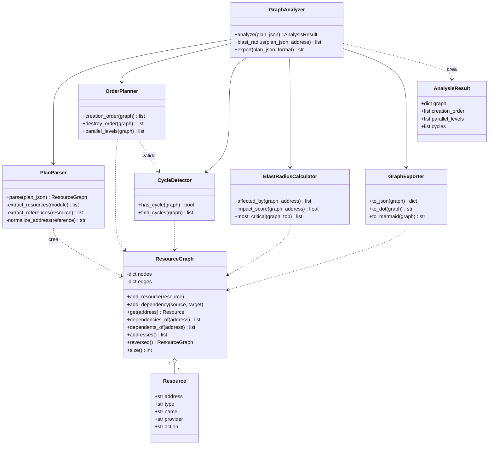
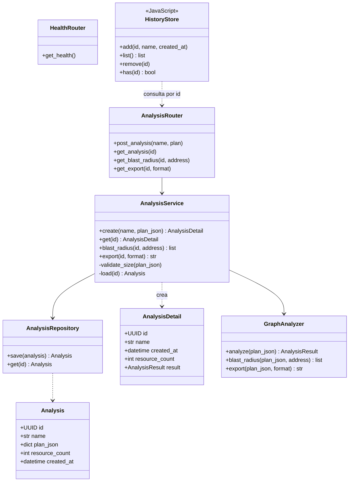
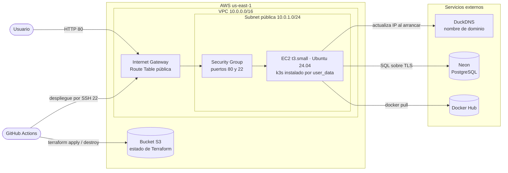
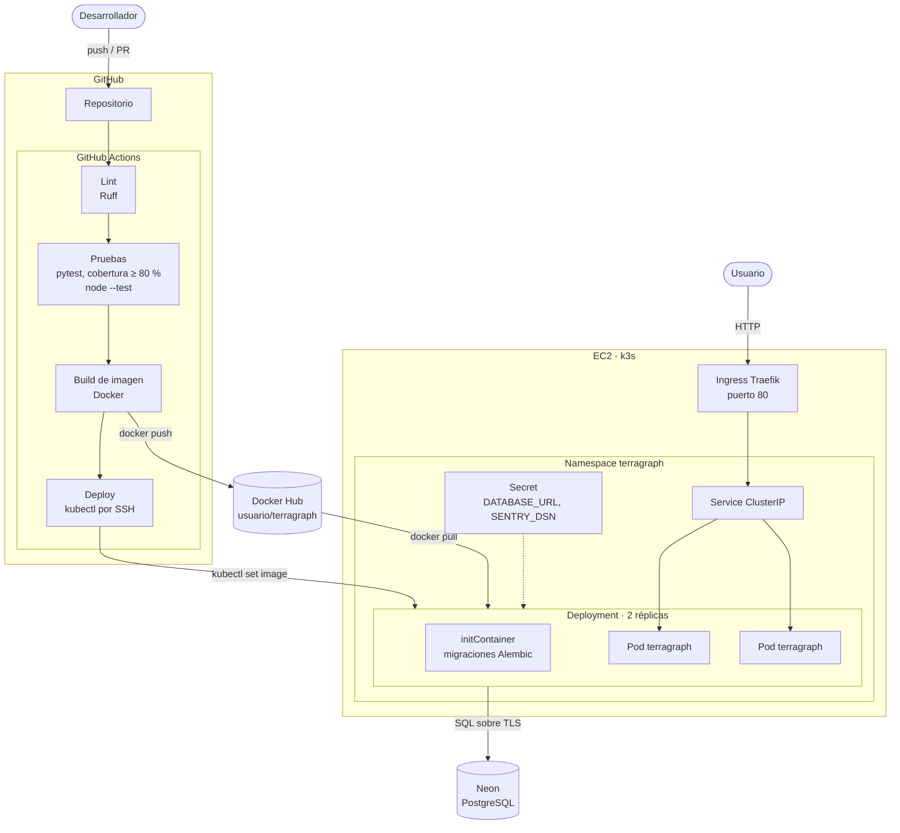
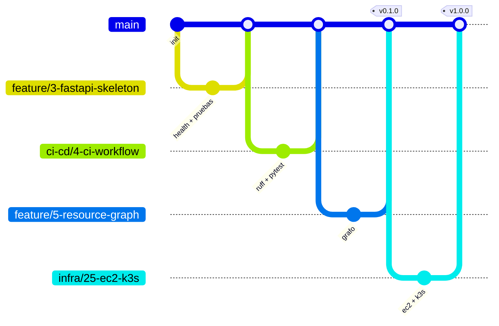

# TerraGraph

**Analizador de infraestructura Terraform basado en grafos**

Proyecto final de CI/CD

---

## 1. Descripción del proyecto

TerraGraph es un servicio web que recibe un plan de Terraform en formato JSON (la salida de `terraform show -json plan.tfplan`), construye el grafo dirigido de dependencias entre recursos y responde tres preguntas:

- **¿En qué orden se crean los recursos?** Orden topológico del grafo, agrupado en niveles que pueden crearse en paralelo.
- **¿Qué se rompe si destruyo este recurso?** Radio de impacto: todos los recursos que dependen, directa o transitivamente, del recurso elegido.
- **¿El plan tiene dependencias circulares?** Detección y reporte de ciclos.

No hay cuentas de usuario. Cada plan que se sube se guarda en PostgreSQL con un identificador aleatorio (UUID) y queda disponible en un enlace propio. La página web recuerda en el navegador los análisis que subió esa persona y los muestra en la sección **Mis análisis**, sin necesidad de iniciar sesión.

Los análisis se guardan en PostgreSQL hospedado en Neon, fuera de AWS. Así la infraestructura de AWS puede destruirse al terminar cada sesión de trabajo sin perder datos ni gastar créditos.

Como demostración, TerraGraph analiza el plan de Terraform de su propia infraestructura.

### Alcance

| Incluido | Fuera de alcance |
|---|---|
| Parseo del JSON de `terraform show` | Ejecutar `terraform plan` o `apply` desde el servicio |
| Orden de creación y destrucción | Estimación de costos |
| Niveles de paralelismo | Soporte de otros IaC (CloudFormation, Pulumi) |
| Radio de impacto | Cuentas de usuario y autenticación |
| Detección de ciclos | Borrar análisis guardados |
| Exportar el grafo a JSON, DOT y Mermaid | Comparar dos planes |
| Guardar y consultar análisis por enlace | Sincronizar el historial entre navegadores |
| Límite de tamaño del plan (2 MB) | |
| Historial **Mis análisis** en el navegador | |
| Visualización web del grafo | |

### Limitaciones conocidas

TerraGraph analiza solo el JSON del plan, no los archivos `.tf`. Ese JSON describe cada argumento de la configuración con un valor constante o con la lista de objetos a los que hace referencia, pero no incluye todo lo que hay en el código fuente. Esto tiene algunas consecuencias:

- **`locals`:** el JSON no incluye los bloques `locals`. Si un recurso usa `local.subnet_id` y ese local apunta a `aws_subnet.public.id`, el parser no puede seguir la referencia y esa dependencia no aparece en el grafo. Las referencias a `local.*` se ignoran sin marcar error.
- **Instancias de `count` y `for_each`:** la configuración no distingue instancias. Una referencia a `aws_instance.app[0]` crea dependencias hacia todas las instancias de `aws_instance.app`. Es una decisión conservadora: es preferible una arista de más que una de menos.
- **Recomendación:** para que el grafo sea completo, conviene usar `locals` solo para valores fijos (etiquetas, nombres, rangos CIDR) y referenciar los recursos directamente. La infraestructura del propio proyecto sigue esta regla, porque se usa como demostración.

Para cubrir estos casos habría que analizar los archivos `.tf` con la librería HCL de Terraform, y eso queda fuera de alcance.

---

## 2. Componentes y métodos

El código se divide en tres capas: el **núcleo de grafos**, que es lógica pura sin dependencias externas; la **aplicación**, que agrega la API y la persistencia; y el **front**, que dibuja el grafo y guarda el historial en el navegador.

### Diagrama de clases: núcleo de grafos



### Diagrama de clases: aplicación y front



### Responsabilidades

| Componente | Responsabilidad | Algoritmo |
|---|---|---|
| `Resource` | Datos de un recurso del plan (dirección, tipo, acción) | — |
| `ResourceGraph` | Grafo dirigido; una arista A → B significa "A depende de B" | Listas de adyacencia |
| `PlanParser` | Convierte el JSON del plan en un `ResourceGraph` a partir de las referencias y los `depends_on` | Recorrido de módulos |
| `CycleDetector` | Encuentra dependencias circulares | DFS con tres colores |
| `OrderPlanner` | Orden de creación, de destrucción y niveles paralelos | Algoritmo de Kahn |
| `BlastRadiusCalculator` | Recursos afectados al destruir uno y ranking de los más críticos | BFS sobre el grafo invertido |
| `GraphExporter` | Serializa el grafo a JSON, DOT y Mermaid | — |
| `GraphAnalyzer` | Fachada del núcleo: orquesta parser y analizadores | — |
| `AnalysisResult` | Grafo, orden de creación, niveles paralelos y ciclos de un plan; si hay ciclos, el orden queda vacío | — |
| `Analysis` | Modelo guardado en PostgreSQL | — |
| `AnalysisRepository` | Acceso a la base de datos | — |
| `AnalysisService` | Valida el tamaño del plan, lo guarda y recalcula el análisis al consultarlo | — |
| `AnalysisDetail` | Datos del análisis guardado (id, nombre, fecha) junto con su `AnalysisResult` recalculado | — |
| `HealthRouter`, `AnalysisRouter` | Endpoints HTTP; convierten los errores del servicio en `404`, `413` y `422` | — |
| `AnalysisCreate`, `AnalysisResponse` | Formato de entrada y salida de la API (Pydantic); FastAPI valida con ellos y genera `/docs` | — |
| `HistoryStore` | Guarda en `localStorage` los análisis que subió esta persona (id, nombre y fecha, máximo 50, sin repetir); si `localStorage` está bloqueado, el historial queda vacío sin romper la página | — |
| `blast-radius.js` | Al hacer clic en un nodo pide su radio de impacto a la API, resalta los afectados, atenúa el resto y muestra cuántos son; un clic en el fondo lo quita | — |
| `node-details.js` | Al hacer clic en un nodo muestra en el panel lateral su dirección, tipo, nombre, proveedor y acción, junto con sus dependencias y dependientes directos; cada relación lleva a ese recurso en el grafo | — |
| `theme.js` | Modo claro y oscuro con un botón en el encabezado; recuerda la elección en `localStorage` y, si no hay una, usa el tema del sistema. Se carga antes de dibujar la página para que no parpadee | — |

Decisiones de diseño:

- **Se guarda el plan, no el resultado.** El análisis se recalcula al consultarlo, así una mejora en los algoritmos aplica también a los análisis ya guardados.
- **Sin autenticación.** La persistencia vive en el servidor y la "identidad" en el cliente. Los análisis no se pueden listar ni borrar desde la API; quien tiene el enlace puede verlo, y el UUID hace que no se pueda adivinar.
- **Límite de 2 MB por plan.** Como cualquiera puede subir planes sin cuenta, el límite evita que se llene la base de datos.

### API

| Método | Ruta | Descripción |
|---|---|---|
| `GET` | `/health` | Verificación de estado para Kubernetes |
| `POST` | `/api/analyses` | Recibe `{"name", "plan"}`, guarda el plan y responde `201` con su `id` y su análisis |
| `GET` | `/api/analyses/{id}` | Grafo, orden de creación, niveles paralelos y ciclos |
| `GET` | `/api/analyses/{id}/blast-radius?address=…` | Recursos afectados por un recurso |
| `GET` | `/api/analyses/{id}/export?format=…` | Grafo en `json`, `dot` o `mermaid`, como texto |
| `GET` | `/` | Página web con la visualización del grafo y **Mis análisis** |

Errores: `404` si el análisis o el recurso no existen; `413` si el plan pesa más de 2 MB; `422` si el plan no es válido o falta un parámetro. El cuerpo siempre es `{"detail": "…"}`.

---

## 3. Stack tecnológico

| Capa | Tecnología | Uso |
|---|---|---|
| Lenguaje | Python 3.12 | Lógica del grafo y API |
| API | FastAPI + Uvicorn | Endpoints REST y documentación OpenAPI automática |
| Validación | Pydantic | Modelos de entrada y salida |
| Base de datos | PostgreSQL en Neon | Análisis guardados; vive fuera de AWS |
| Acceso a datos | SQLAlchemy + Alembic | Modelos, consultas y migraciones |
| Front | HTML + JavaScript + Cytoscape.js | Dibujo interactivo del grafo e historial en `localStorage`, servido por FastAPI |
| Pruebas | pytest + pytest-cov + httpx2; `node --test` | Pruebas unitarias, cobertura y `TestClient`; pruebas del JavaScript de la página sin dependencias |
| Calidad | Ruff | Lint y formato |
| Monitoreo | Sentry (plan Developer, gratuito) | Errores y rendimiento de la API, separados por entorno y versión |
| Entorno local | venv + Docker Compose | Dependencias de Python y Postgres en contenedor |
| Contenedor | Docker (multi-stage) | Imagen de la aplicación |
| Registro | Docker Hub | Almacén de imágenes versionadas |
| CI/CD | GitHub Actions | Pruebas, build, push, despliegue e infraestructura |
| IaC | Terraform con estado en S3 | Creación y destrucción de la infraestructura |
| Nube | AWS (VPC, EC2, S3) | Hospedaje y estado de Terraform |
| Orquestación | k3s (Kubernetes) + Traefik | Ejecución del contenedor y entrada HTTP |
| DNS | DuckDNS | Nombre fijo aunque cambie la IP |
| Gestión | GitHub Projects + Issues | Plan de trabajo |
| Documentación | GitHub Wiki + README | Presentación del proyecto (en inglés en la Wiki) e inicio rápido |

### Entorno local

```bash
python -m venv .venv
.venv\Scripts\Activate.ps1          # Windows (PowerShell)
pip install -r requirements-dev.txt
uvicorn app.main:app --reload       # levantar la API
python -m pytest                    # correr las pruebas
ruff check . && ruff format --check .
```

- `requirements.txt` tiene lo que la app necesita para correr; `requirements-dev.txt` agrega las herramientas de desarrollo.
- Las versiones de las dependencias directas están fijadas para que el entorno sea reproducible.
- Las pruebas se ejecutan con `python -m pytest`, que agrega la raíz del proyecto a la ruta de búsqueda de módulos.

---

## 4. Recursos que se van a crear

### Diagrama de infraestructura



El usuario entra por el nombre de DuckDNS, que apunta a la IP pública de la instancia. Terraform, ejecutado desde GitHub Actions, crea y destruye todo lo que está dentro de la VPC.

### Recursos de Terraform

| Recurso | Tipo | Propósito |
|---|---|---|
| Red | `aws_vpc` | Red aislada del proyecto |
| Subred | `aws_subnet` | Subred pública para la instancia, fija en `us-east-1a` |
| Salida a internet | `aws_internet_gateway` | Acceso desde y hacia internet |
| Rutas | `aws_route_table`, `aws_route_table_association` | Ruta por defecto hacia el gateway |
| Firewall | `aws_security_group`, `aws_vpc_security_group_ingress_rule`, `aws_vpc_security_group_egress_rule` | Entrada por el puerto 80 para la aplicación y 22 para el despliegue; salida libre. Cada regla es un recurso aparte |
| Llave | `aws_key_pair` | Llave pública para el acceso SSH del pipeline |
| Servidor | `aws_instance` | EC2 con k3s instalado por `user_data` |
| Estado | backend `s3` | Guarda el estado para que el pipeline pueda aplicar y destruir; el bloqueo usa un archivo en el mismo bucket (`use_lockfile`), sin DynamoDB |

El `user_data` de la instancia (`terraform/user_data.sh.tftpl`) instala k3s, registra la IP en DuckDNS, crea el `Secret` de Kubernetes y aplica los manifiestos del repositorio. Terraform lee los `.yaml` de `k8s/` y los incluye en el `user_data`, así la instancia aplica la misma versión con la que se corrió `terraform apply`. La actualización de DuckDNS se repite en cada arranque, por si el laboratorio apaga y vuelve a prender la instancia con otra IP. La instancia se crea después de la ruta a internet y de la regla de salida (`depends_on`), porque sin ellas el `user_data` no podría descargar k3s.

### Recursos fuera de Terraform

| Recurso | Dónde | Permanencia |
|---|---|---|
| Bucket S3 del estado | AWS | Permanente; se crea una sola vez |
| Base de datos PostgreSQL | Neon | Permanente |
| Subdominio | DuckDNS | Permanente |
| Repositorio de imágenes | Docker Hub | Permanente |

Todo lo que cuesta créditos (VPC y EC2) se crea y se destruye en cada sesión. Lo permanente es gratuito o de costo mínimo.

El bucket del estado se crea una sola vez con `terraform/bootstrap/create-state-bucket.sh` (AWS CLI), con versionado y acceso público bloqueado. Se llama `terragraph-tfstate-<ID de la cuenta>` porque los nombres de bucket son únicos en todo AWS. Ese nombre no se escribe en el código: se pasa con `terraform init -backend-config="bucket=…"` y, en los workflows, sale de la variable del repositorio `TF_STATE_BUCKET`.

### Ciclo de una sesión de trabajo

1. Iniciar el laboratorio de AWS y copiar las credenciales temporales a los secretos de GitHub.
2. Ejecutar el workflow **infra-up**: `terraform apply` crea la red y la instancia, y la aplicación queda disponible con los datos de la sesión anterior.
3. Trabajar normalmente: cada merge a `main` despliega la versión nueva.
4. Ejecutar el workflow **infra-down**: `terraform destroy` elimina todo lo que consume créditos.

### Diagrama de deployment



Los pods no guardan nada en disco: los análisis están en Neon y el historial de cada persona vive en su navegador. Por eso las dos réplicas son intercambiables y el rolling update no pierde información.

Los manifiestos están en `k8s/`, numerados para que `kubectl apply -f k8s/` cree primero el namespace:

| Archivo | Recurso | Detalle |
|---|---|---|
| `00-namespace.yaml` | `Namespace` | `terragraph` |
| `01-deployment.yaml` | `Deployment` | 2 réplicas; rolling update con `maxSurge: 1` y `maxUnavailable: 0`; `initContainer` con `alembic upgrade head`; probes de readiness y liveness sobre `/health`; usuario `10001` sin privilegios; `DATABASE_URL` y `SENTRY_DSN` desde el `Secret` |
| `02-service.yaml` | `Service` | `ClusterIP`, puerto 80 hacia el 8000 de los pods |
| `03-ingress.yaml` | `Ingress` | Traefik en el puerto 80, sin `host`: responde por el dominio y por la IP |

El `Secret` no está en el repositorio: lo crea el `user_data` con los valores sensibles de Terraform. La imagen tampoco está escrita en los manifiestos: Terraform los lee como plantillas y pone `<usuario>/terragraph:latest` a partir de la variable `dockerhub_username`; el despliegue la cambia después a `sha-<commit>`.

### Workflows

| Workflow | Disparador | Qué hace |
|---|---|---|
| `ci.yml` | Pull request hacia `main` | Lint, pruebas con cobertura, pruebas del JavaScript (`test-js`) y build de la imagen sin publicar |
| `cd.yml` | Merge a `main` o tag `vX.Y.Z` | Lint, pruebas, build, push a Docker Hub y despliegue |
| `infra-up.yml` | Manual | `terraform apply` y espera a que `/health` responda por el dominio |
| `infra-down.yml` | Manual, escribiendo `destroy` para confirmar | `terraform destroy` |
| `terraform.yml` | Llamado por `infra-up` e `infra-down` (`workflow_call`) | Credenciales, variables, `init`, plan y apply del plan guardado |

`infra-up` e `infra-down` llaman al mismo workflow reutilizable (`terraform.yml`), así las credenciales, las variables `TF_VAR_…` y el `init` están en un solo lugar. Los dos comparten un grupo de `concurrency`: si se lanzan seguidos, el segundo espera al primero. `terraform apply` termina antes de que la aplicación arranque, porque el `user_data` todavía instala k3s y corre las migraciones; por eso `infra-up` tiene un segundo job que consulta `/health` por el dominio hasta 15 minutos y deja en el resumen del run la URL, la IP y el comando SSH.

El despliegue (job `deploy` de `cd.yml`) corre solo en merges a `main`: se conecta por SSH a la instancia, usando su nombre de DuckDNS, y ejecuta `kubectl set image` con la etiqueta `sha-<commit>` y `kubectl rollout status`. Si el rollout no termina en 5 minutos, `kubectl rollout undo` regresa a la imagen anterior y el job falla; como el rolling update usa `maxUnavailable: 0`, la aplicación no deja de responder. Al final consulta `/health` por el dominio. Si la infraestructura está apagada (el puerto 22 no responde), el despliegue se omite con un aviso y la imagen queda publicada para la siguiente sesión. La llave del servidor cambia cada vez que se recrea la instancia, así que se lee con `ssh-keyscan` en cada despliegue. Un tag `vX.Y.Z` publica la imagen con su versión, pero no la despliega.

El despliegue no usa credenciales de AWS; solo los workflows de infraestructura las necesitan. El puerto 22 queda abierto a internet porque los runners de GitHub no tienen IP fija, así que el acceso se protege con la llave y no con el firewall.

### Pruebas unitarias

Las pruebas corren con pytest en cada pull request. El pipeline falla si alguna prueba falla o si la cobertura baja de 80 %. El JavaScript de la página (`HistoryStore`, el radio de impacto, los detalles del recurso y el tema) se prueba aparte con el runner que trae Node (`node --test`, job `test-js`), sin `package.json` ni dependencias.

| Módulo | Casos principales |
|---|---|
| `/health` | Responde `200` con `{"status": "ok"}`; una ruta inexistente responde `404` |
| `ResourceGraph` | Agregar nodos y aristas; dependencias y dependientes; grafo invertido; recurso inexistente |
| `PlanParser` | Plan mínimo; referencias entre recursos; `depends_on` explícito; módulos anidados; recursos con `count`; JSON inválido; recurso sin un campo obligatorio; referencia a un módulo u output inexistente; referencias dentro de bloques anidados (`ingress`, `ebs_block_device`) |
| `CycleDetector` | Grafo sin ciclos; ciclo simple; ciclo largo; autorreferencia; varios ciclos |
| `OrderPlanner` | Grafo vacío; cadena lineal; grafo en diamante; un recurso espera a su dependencia más lenta; componentes desconectados; el orden de creación respeta todas las dependencias; el orden de destrucción es el inverso; error `CyclicGraphError` si hay ciclo o autorreferencia |
| `BlastRadiusCalculator` | Nodo hoja (sin afectados); nodo raíz (todos afectados); dependencias transitivas; un ciclo no se queda en bucle; recurso inexistente; ranking de críticos con empates y `top`; grafo vacío; `top` negativo |
| `GraphExporter` | Salida válida en JSON, DOT y Mermaid; grafo vacío; recurso sin aristas; direcciones con comillas (`for_each`) |
| `GraphAnalyzer` | Análisis completo de un plan; acepta texto o dict; con ciclo los reporta y deja el orden vacío; plan inválido; radio de impacto y recurso inexistente; exportar en JSON, DOT y Mermaid; formato no soportado |
| `Analysis` | Se guarda con UUID y fecha de creación; el plan se recupera igual; IDs únicos; nombre obligatorio; URL de conexión (local, `DATABASE_URL` y formato de Neon) |
| `AnalysisRepository` | Contra Postgres real: guardar y consultar; `id` y fecha asignados; `None` si el id no existe; el plan se guarda como `jsonb` |
| `AnalysisService` | Guardar y consultar; el `id` es un UUID; plan de más de 2 MB rechazado; análisis inexistente |
| Routers | Códigos `200`, `404`, `413` y `422` con el `TestClient` de FastAPI |
| `HistoryStore` | Guardar del más reciente al más antiguo; persiste entre instancias; id repetido no se duplica; quitar una entrada; tope de 50; valor dañado en `localStorage`; `localStorage` bloqueado o lleno |
| `blast-radius.js` | URL con direcciones con comillas; mensaje con 0, 1 y varios afectados; resalta el recurso, sus afectados y las aristas entre ellos; atenúa el resto; recurso sin afectados; elegir otro recurso reemplaza el resaltado; quitar el resaltado. Usa Cytoscape en modo *headless* (sin navegador) |
| `node-details.js` | Datos del recurso; dependencias y dependientes directos separados y ordenados; recurso raíz y recurso sin dependientes; ciclo; recurso inexistente. También con Cytoscape *headless* |
| `theme.js` | Sin tema guardado usa el del sistema; el guardado gana; valor inválido ignorado; `localStorage` bloqueado o ausente; alternar entre claro y oscuro |

- **Unitarias:** el núcleo de grafos no necesita nada externo. El servicio se prueba con un repositorio en memoria.
- **Integración:** el repositorio se prueba contra un contenedor de Postgres que GitHub Actions levanta como servicio.
- **Datos de prueba:** planes JSON pequeños en `tests/fixtures/`, además del plan real de la infraestructura del proyecto.

### Docker Hub

- **Repositorio:** `<usuario>/terragraph` (público).
- **Imagen:** build multi-stage sobre `python:3.12-slim`, ejecutada con usuario sin privilegios. Solo instala `requirements.txt`. La misma imagen corre las migraciones en el `initContainer`.
- **Archivos:** `docker/Dockerfile` y `docker/Dockerfile.dockerignore`, junto al `docker-compose.yml`. La imagen se construye desde la raíz del repo con `docker build -f docker/Dockerfile -t terragraph .` y escucha en el puerto 8000.
- **Etiquetas:**
  - `sha-<commit>`: una por cada merge a `main`, con el SHA completo del commit (el mismo valor que `github.sha`); es la que se despliega, para poder regresar a una versión exacta.
  - `latest`: la última versión de `main`.
  - `X.Y.Z`: versiones liberadas con un tag de Git.
- **Publicación:** en un pull request la imagen solo se construye; `cd.yml` la publica después de correr el lint y las pruebas, reutilizando los jobs de `ci.yml` (`workflow_call`) en lugar de copiarlos.

### Secretos en GitHub

| Secreto | Uso | Se renueva |
|---|---|---|
| `DOCKERHUB_TOKEN` | Publicar la imagen (token de acceso con permiso *Read & Write*) | No |
| `AWS_ACCESS_KEY_ID`, `AWS_SECRET_ACCESS_KEY`, `AWS_SESSION_TOKEN` | Terraform (`infra-up` e `infra-down`) | En cada sesión |
| `EC2_SSH_KEY` | Llave privada para el despliegue por SSH | No |
| `DATABASE_URL` | Conexión a Neon | No |
| `SENTRY_DSN` | Enviar errores y rendimiento a Sentry desde producción | No |
| `DUCKDNS_TOKEN` | Actualizar el nombre de dominio | No |

`DOCKERHUB_USERNAME`, `DUCKDNS_DOMAIN` y `TF_STATE_BUCKET` se guardan como **variables** del repositorio y no como secretos: no son datos sensibles y, si fueran secretos, GitHub los taparía con `***` en los logs, incluidos el nombre de la imagen, el dominio y el bucket. `DOCKERHUB_USERNAME` también llega a Terraform (`TF_VAR_dockerhub_username`) para armar el nombre de la imagen en el `Deployment`.

`DATABASE_URL` y `SENTRY_DSN` llegan a la instancia como variables sensibles de Terraform (`TF_VAR_…` en los workflows, `terraform.tfvars` en local) y terminan en el `Secret` `terragraph` del namespace `terragraph`. La llave pública de SSH se guarda en el repositorio (`terraform/keys/terragraph.pub`), por lo que la misma llave sirve aunque la instancia se recree.

---

## 5. Estrategia de ramas

Se usa **GitHub Flow**: una sola rama estable y ramas cortas por issue.



| Regla | Detalle |
|---|---|
| Rama estable | `main`, siempre desplegable y protegida |
| Nombres de ramas | `<tipo>/<issue>-<descripción-en-inglés>`, con tipo `feature`, `fix`, `test`, `ci-cd`, `infra` o `docs` (por ejemplo `docs/2-wiki-presentation`) |
| Creación de ramas | Desde el issue (**Development → Create a branch**), para que quede ligada |
| Integración | Solo por pull request; los checks de lint y pruebas son obligatorios |
| Merge | Squash merge, para dejar un commit por issue |
| Commits | Conventional Commits (`feat:`, `fix:`, `test:`, `ci:`, `docs:`, `chore:`) |
| Versiones | Tags `vX.Y.Z` sobre `main` con versionado semántico |
| Cierre de issues | El PR incluye `Closes #<issue>` |
| Limpieza | La rama se borra después del merge; el registro queda en el PR y el issue |

---

## 6. Plan de trabajo

### Calendario

Las fechas de cada milestone se registran en GitHub y se ajustan al ritmo de la clase.

| Semana | Milestone | Entregable |
|---|---|---|
| 1 | M1 · Base | Repositorio, Wiki, board, esqueleto del proyecto y CI mínimo |
| 2 | M2 · Núcleo de grafos | `ResourceGraph`, `PlanParser` y `CycleDetector` con pruebas |
| 3 | M3 · Análisis | `OrderPlanner`, `BlastRadiusCalculator`, exportador y `GraphAnalyzer` |
| 4 | M4 · Persistencia y API | Postgres, migraciones, repositorio, servicio y endpoints |
| 5 | M5 · Contenedor | Dockerfile, Docker Hub y build en el pipeline |
| 6 | M6 · Infraestructura y despliegue | Terraform, k3s, workflows de infraestructura y despliegue continuo |
| 7 | M7 · Visualización y cierre | Página web, historial local, demo con el plan propio y documentación final |

### GitHub Project Board

- **Columnas:** Backlog → To Do → In Progress → In Review → Done.
- **Campos:** Milestone, Prioridad (alta, media, baja), Tamaño (S, M, L), Etiqueta.
- **Etiquetas:** `feature`, `test`, `ci-cd`, `infra`, `docs`, `bug`.
- **Qué entra al board:** solo los issues, una tarjeta por unidad de trabajo. Los pull requests no se agregan como tarjetas; cada uno queda ligado a su issue en **Development** y se consulta desde ahí.
- **Automatización:** todo issue nuevo entra solo al board; al abrir un PR ligado con `Closes #<issue>`, la tarjeta del issue pasa a In Review, y al cerrarse el issue pasa sola a Done.
- **Flujo por issue:**
  1. El issue está en **To Do** con milestone, etiqueta y tamaño.
  2. Al crear la rama desde el issue, la tarjeta pasa a **In Progress**.
  3. Al abrir el PR con `Closes #<issue>`, pasa a **In Review**.
  4. Al hacer squash merge, el issue se cierra y la tarjeta pasa a **Done**.
- **Cambios al plan:** un issue descartado se cierra como *Not planned* con un comentario que explica el motivo.

### Issues

| # | Issue | Etiqueta | Milestone | Tamaño |
|---|---|---|---|---|
| 1 | Protección de `main`, etiquetas y plantillas de issue y PR | `docs` | M1 | S |
| 2 | Publicar la presentación en la Wiki | `docs` | M1 | S |
| 3 | Esqueleto FastAPI con `/health` y pruebas | `feature` | M1 | S |
| 4 | Workflow de CI con Ruff y pytest en pull requests | `ci-cd` | M1 | M |
| 5 | Implementar `Resource` y `ResourceGraph` con pruebas | `feature` | M2 | M |
| 6 | Implementar `PlanParser` para el JSON de `terraform show` | `feature` | M2 | L |
| 7 | Fixtures de planes y pruebas de `PlanParser` | `test` | M2 | M |
| 8 | Implementar `CycleDetector` con pruebas | `feature` | M2 | M |
| 43 | Cubrir en las pruebas las ramas faltantes de `PlanParser` | `test` | M2 | S |
| 9 | Implementar `OrderPlanner` (orden y niveles paralelos) con pruebas | `feature` | M3 | M |
| 10 | Implementar `BlastRadiusCalculator` con pruebas | `feature` | M3 | M |
| 47 | Mover `make_graph` y las constantes de prueba a un módulo compartido | `test` | M3 | S |
| 11 | Implementar `GraphExporter` (JSON, DOT, Mermaid) con pruebas | `feature` | M3 | S |
| 12 | Implementar `GraphAnalyzer` como fachada del núcleo, con pruebas | `feature` | M3 | S |
| 13 | Docker Compose con Postgres local y modelo `Analysis` | `feature` | M4 | M |
| 14 | Migraciones con Alembic | `feature` | M4 | S |
| 15 | `AnalysisRepository` y pruebas de integración con Postgres en CI | `test` | M4 | M |
| 16 | `AnalysisService`: guardar y consultar, UUID y límite de 2 MB, con pruebas | `feature` | M4 | M |
| 17 | `AnalysisRouter`: endpoints de análisis, radio de impacto y exportación | `feature` | M4 | M |
| 18 | Pruebas de la API y umbral de cobertura de 80 % | `test` | M4 | M |
| 19 | Crear la base de datos en Neon | `infra` | M4 | S |
| 58 | Monitoreo de errores y rendimiento con Sentry | `feature` | M4 | S |
| 20 | Dockerfile multi-stage con usuario sin privilegios | `ci-cd` | M5 | S |
| 21 | Crear repositorio en Docker Hub y secretos en GitHub | `ci-cd` | M5 | S |
| 22 | Job de build y push con etiquetas `latest`, `sha` y versión | `ci-cd` | M5 | M |
| 23 | Bucket S3 y backend remoto para el estado de Terraform | `infra` | M6 | S |
| 24 | Terraform: VPC, subred, gateway, rutas y security group | `infra` | M6 | M |
| 25 | Terraform: EC2 con k3s por `user_data`, key pair y DuckDNS | `infra` | M6 | L |
| 26 | Manifiestos: Deployment con migraciones, Service, Ingress, Secret y probes | `infra` | M6 | M |
| 27 | Workflows manuales `infra-up` e `infra-down` | `ci-cd` | M6 | M |
| 28 | Job de despliegue por SSH con `kubectl set image` y verificación del rollout | `ci-cd` | M6 | M |
| 29 | Página web: subir un plan y dibujar el grafo con Cytoscape.js | `feature` | M7 | L |
| 30 | Historial **Mis análisis** en `localStorage` | `feature` | M7 | M |
| 31 | Resaltar el radio de impacto al seleccionar un nodo | `feature` | M7 | M |
| 32 | Opcional: HTTPS con Let's Encrypt en Traefik (*Not planned*) | `infra` | M7 | M |
| 33 | Demo: analizar el plan de la infraestructura propia | `docs` | M7 | S |
| 34 | README, Wiki final y release `v1.0.0` | `docs` | M7 | S |

---

## 7. Entregables

- **Presentación del proyecto:** la Wiki de GitHub (en inglés), este documento y su versión en PDF.
- **Plan de proyecto:** GitHub Project Board con los 37 issues y 7 milestones.

---

## Historial del plan

| Versión | Fecha | Cambio |
|---|---|---|
| 1 | Octubre 2026 | Plan original, con inicio de sesión con GitHub y análisis por usuario |
| 2 | Noviembre 2026 | Se quitó la autenticación; los análisis se guardan por enlace (UUID) con límite de 2 MB y el historial vive en el navegador. Se reinició el repositorio para seguir el plan desde el issue #1. El board lleva solo issues; los PR se consultan desde su issue. Los nombres de las ramas van en inglés |
| 3 | Noviembre 2026 | Se documentaron las limitaciones conocidas del análisis (`locals` e instancias de `count`/`for_each`). Se agregó el issue #43 para probar tres casos de `PlanParser` que no tenían pruebas: recurso sin un campo obligatorio, referencia a un módulo u output inexistente y referencias dentro de bloques anidados; `parser.py` queda con 100 % de cobertura |
| 4 | Noviembre 2026 | Se agregó el issue #47: la función auxiliar `make_graph` y las constantes `A`–`E` estaban copiadas en `test_cycles.py`, `test_order.py` y `test_blast_radius.py`; se mueven a `tests/core/helpers.py` para tenerlas en un solo lugar. Solo cambia el código de las pruebas, no el de la aplicación |
| 5 | Noviembre 2026 | Se agregó el issue #58: la aplicación debe tener monitoreo, requisito que no estaba en el plan original. Se usa Sentry en su plan gratuito (errores y tracing) y se integra desde M4 para registrar la evolución del proyecto durante el desarrollo. Sentry solo se activa si existe `SENTRY_DSN`, así que las pruebas y el CI no mandan eventos; el secreto se usará en el despliegue |
| 6 | Noviembre 2026 | Issue #24: las reglas del security group se crean como recursos aparte (`aws_vpc_security_group_ingress_rule` y `aws_vpc_security_group_egress_rule`), como recomienda el proveedor de AWS, y la regla de salida se declara porque Terraform borra la que AWS crea por defecto. La subred se fija en `us-east-1a` para que exista el tipo de instancia del issue #25 |
| 7 | Noviembre 2026 | Issue #25: Terraform incluye los manifiestos de `k8s/` en el `user_data` en lugar de descargarlos de GitHub; el `Secret` lleva `DATABASE_URL` y `SENTRY_DSN`; DuckDNS se actualiza en cada arranque (script *per-boot* de cloud-init); la instancia usa IMDSv2 obligatorio, disco gp3 de 20 GB y depende explícitamente de la ruta y de la regla de salida |
| 8 | Noviembre 2026 | Issue #26: los manifiestos de `k8s/` llevan número para aplicarse en orden; la imagen del `Deployment` se arma con la variable de Terraform `dockerhub_username` en lugar de escribirla en el YAML; el `Secret` lo sigue creando el `user_data` y no se guarda en el repo |
| 9 | Noviembre 2026 | Issue #27: `infra-up` e `infra-down` llaman a un workflow reutilizable (`terraform.yml`) para no repetir credenciales ni variables; `infra-down` pide escribir `destroy` para confirmar; `infra-up` espera a que `/health` responda por el dominio. Se agregó la variable del repositorio `DUCKDNS_DOMAIN` |
| 10 | Noviembre 2026 | Issue #28: el despliegue corre solo en merges a `main` (los tags publican la imagen sin desplegarla); si el rollout falla se hace `kubectl rollout undo` automáticamente; se omite con un aviso si el puerto 22 no responde; la llave del servidor se lee con `ssh-keyscan` porque cambia en cada sesión; al final se verifica `/health` por el dominio |
| 11 | Noviembre 2026 | Issue #29: la página está en `app/static/` (HTML, CSS y JavaScript sin build) y FastAPI la sirve en `/` y `/static`, así entra en la misma imagen; un análisis se abre con `/?id=<uuid>`; Cytoscape.js 3.34.0 se guarda en `app/static/vendor/` (con su licencia MIT) en lugar de cargarlo de un CDN, así la imagen es autosuficiente, y los nodos se acomodan con los niveles paralelos de la API (layout `preset`), así cada flecha apunta hacia abajo; si hay ciclos se usa `cose`. Ninguno necesita extensiones; los nodos se colorean por acción y las aristas de un ciclo se marcan en rojo |
| 12 | Noviembre 2026 | Issue #30: `HistoryStore` va en `app/static/history.js` y se prueba con `node --test` en un job nuevo de CI (`test-js`), del que depende el build. Solo se guardan los planes subidos desde ese navegador, no los que se abren por un enlace compartido; el historial guarda como máximo 50 análisis. **Quitar** borra la entrada solo del historial, no del servidor. Si un análisis del historial responde `404`, se quita solo y se muestra un aviso |
| 13 | Noviembre 2026 | Issue #31: el resaltado va en `app/static/blast-radius.js` y se prueba en el job `test-js` con la misma copia de Cytoscape de `vendor/` en modo *headless*, sin agregar dependencias. Se resaltan el recurso elegido, los afectados y las aristas entre ellos; el resto queda al 15 % de opacidad. Si se hace clic en otro nodo antes de que llegue la respuesta, la anterior se ignora |
| 14 | Noviembre 2026 | El issue #32 (HTTPS opcional con Let's Encrypt) se cerró como *Not planned*; la aplicación se queda en HTTP |
| 15 | Noviembre 2026 | Issue #34: la Wiki se publica en inglés y en varias páginas (Home, Architecture, API, Infrastructure, CI/CD, Testing, Development y Work plan); este documento y el PDF se quedan en español. El README explica el uso, el entorno local, la configuración y el despliegue, y documenta los hallazgos de la demo (#33): un plan trae en texto plano los valores de las variables `sensitive`, los secretos viven en tres lugares (`.env`, `terraform.tfvars` y GitHub) y **Mis análisis** se pierde si el navegador borra los datos al cerrarse |
